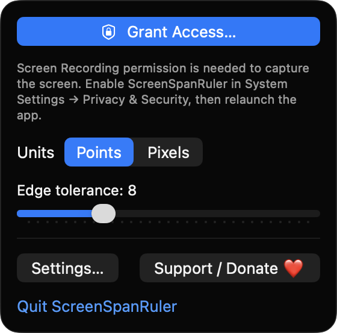
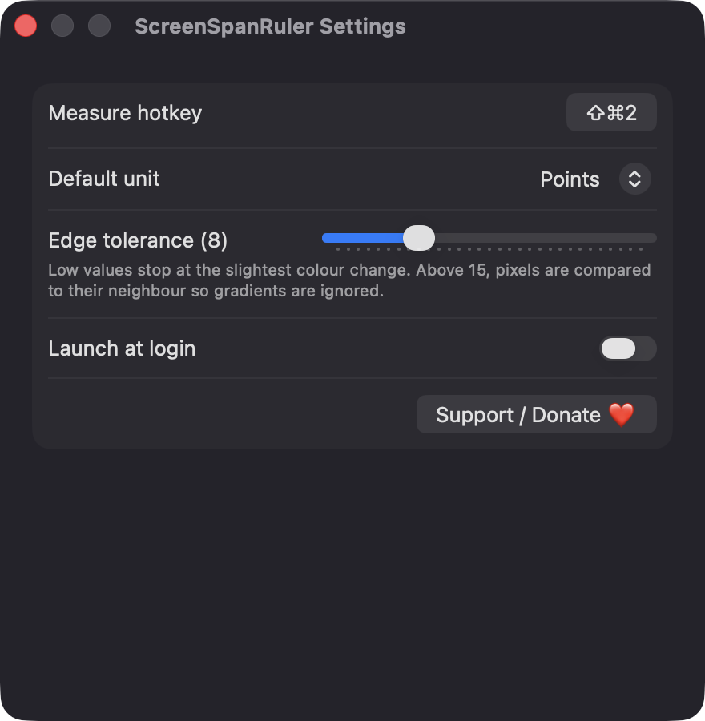

# ScreenSpanRuler

**🌐 Website:** [turhe123.github.io/screen-span-ruler](https://turhe123.github.io/screen-span-ruler/)

Measure distances and gaps between any elements on screen in pixels using automatic edge detection.


## Why

ScreenSpanRuler is a free, open-source, 100% native, backend-free alternative to paid utilities in the *Screen & OCR* category. It was inspired by Pixelsnap ($29 one-time), the well-loved screen ruler that snaps to the edges of whatever is on screen. ScreenSpanRuler offers edge-snapping measurement plus a few essentials, with no accounts, no servers and no network access.

## Features

- **Menu bar app**: no main window and no Dock icon. A ruler icon in the menu bar gives you Start Measuring, a Points/Pixels toggle, an edge tolerance slider (0–30), Settings and Quit.
- **Global hotkey** (default `⇧⌘2`) that freezes every connected display into a screenshot and opens a full-screen overlay on each. The hotkey can be re-recorded in Settings.
- **Automatic edge detection**: horizontal and vertical lines extend from the pointer until they hit a color change beyond the tolerance, with the distance shown in a pill label on each line.
- **Gradient-friendly**: above a tolerance of 15, each pixel is compared with its neighbor instead of the starting pixel, so smooth gradients don't stop the scan.
- **Drag to measure a box**: drag a rectangle and it shrinks to fit the content inside it, then shows width × height.
- **Shift** locks the crosshair to one axis.
- **Arrow keys** nudge the crosshair by exactly one pixel.
- **`U`** toggles between points and true pixels; the help strip shows the active unit and display scale (for example `@2x`).
- **`C`** copies the current measurement (e.g. `120 pt × 48 pt`) to the clipboard.
- **`Esc`** exits and releases the captured screenshots from memory.
- **Multi-display aware**: each display is captured at its native resolution and converted using its own scale factor. Measuring is limited to the display under the pointer.
- **Settings**: hotkey recorder, default unit, tolerance and launch at login.
- **Menu bar and Dock regions are measurable**, since the capture covers the whole display.

## Screenshots

<p align="center"></p>

<p align="center"><em>The ScreenSpanRuler menu bar panel, with the Screen Recording access button, a Points/Pixels unit toggle, an edge tolerance slider, and links to Settings and Support.</em></p>

<p align="center"></p>

<p align="center"><em>The Settings window, where you record the measure hotkey (⇧⌘2 by default), choose the default unit, adjust edge tolerance and turn on launch at login.</em></p>

## Install

1. Download `ScreenSpanRuler-macOS.zip` from the [latest release](https://github.com/turhe123/screen-span-ruler/releases/latest).
2. Unzip it and move `ScreenSpanRuler.app` to `/Applications`.
3. Because the app is open source and not notarized, clear the quarantine flag:

   ```bash
   xattr -cr /Applications/ScreenSpanRuler.app
   ```

4. The first time, right-click the app and choose **Open**.

## Build from source

Requires macOS 14+ and Xcode with the Swift 5.9+ toolchain.

```bash
brew install xcodegen
xcodegen generate
xcodebuild -project ScreenSpanRuler.xcodeproj -scheme ScreenSpanRuler -configuration Release -derivedDataPath ./build build
```

The app is produced at `build/Build/Products/Release/ScreenSpanRuler.app`.

## Permissions

- **Screen Recording** (required): used to capture a one-time screenshot of each display so edges can be detected. Until it is granted, the menu shows **Grant Access…** instead of **Start Measuring**. After enabling it in System Settings → Privacy & Security, relaunch the app.
- **Notifications** (optional): used only to tell you if a screen capture fails. If you decline, an alert dialog is shown instead.
- **Login item** (optional): only if you turn on *Launch at login* in Settings.

ScreenSpanRuler does **not** request Accessibility or Microphone access. The global hotkey uses the Carbon hotkey API, which needs no special permission.

## Built with AI

ScreenSpanRuler was written by [Claude Code](https://claude.com/claude-code) inside an automated pipeline, from a plain-English spec. No code, binaries or assets from any commercial app were used; it is a clean-room reimplementation of a feature set, not a copy.

What that means in practice:

- The full source is in this repo under the MIT license. Read it before you run it.
- No network calls, no analytics, no third-party dependencies. Only Apple frameworks.
- Ad-hoc signed and not notarized, which is why Gatekeeper warns on first launch.
- It has had less human review than a hand-written app. Bug reports and pull requests are welcome.

## Support ❤️

If ScreenSpanRuler saves you time, you can support its development:

[Support Or (Leo) Davidai ❤️ on Ko-fi](https://ko-fi.com/leodavidai)

## License

MIT © Or Davidai Bachar
